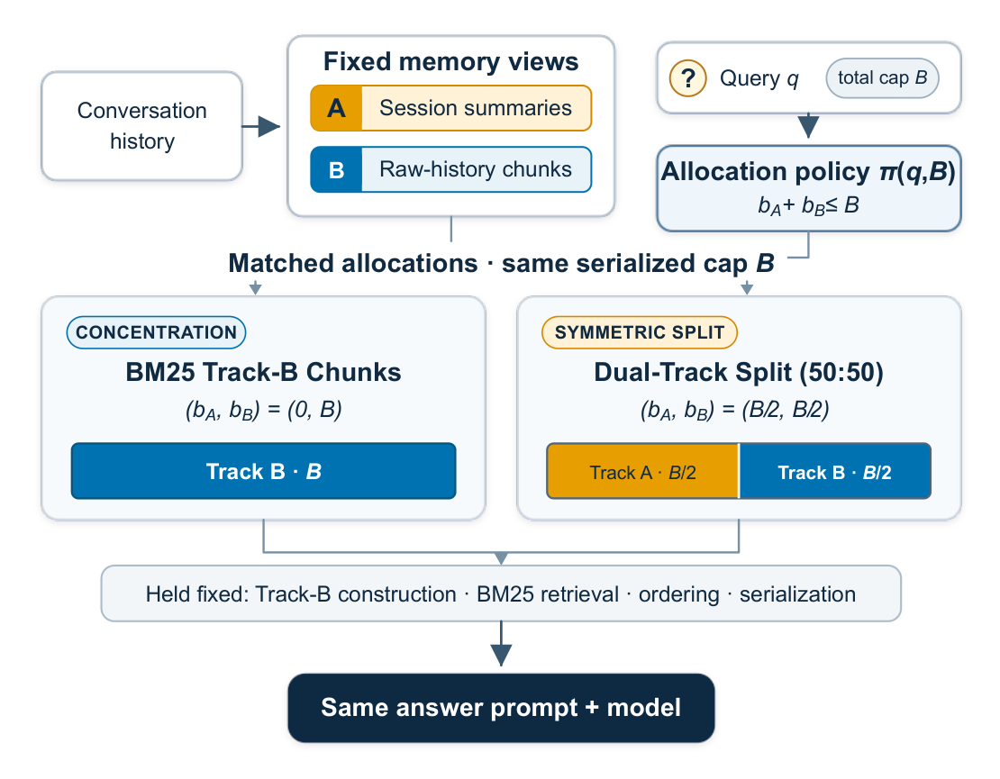

# When Splitting Beats Concentrating

**Memory Allocation in Long-Term Conversational Agents**  
EACL 2027 · Zihe Guo, Cai Xu, Liqiang Shang, Yilun Zhao

[Experiments](PAPER_EXPERIMENT_MAP.md) · [Datasets](DATA.md) · [Citation](CITATION.cff)

How should a conversational agent spend a fixed memory budget? We compare two ways to use the same conversation history. One gives the entire budget to retrieved dialogue chunks. The other splits it evenly between chunks and session summaries. Both use the same answer model and prompt.

<p align="center">
  
</p>

On **LongMemEval-S**, chunks alone lead at 1,000 characters. The two allocations are nearly tied at 2,000, and the split leads at 4,000 and 6,000. The paper reports the following accuracies on 500 questions.

| Query-time memory budget | 1k chars | 2k chars | 4k chars | 6k chars |
|---|---:|---:|---:|---:|
| Chunks only | 34.4% | 41.0% | 43.4% | 42.8% |
| Half summaries, half chunks | 22.2% | 40.6% | 48.4% | 51.4% |

The release defaults to the same full BM25 ranking for both allocations. Each policy skips chunks that exceed its remaining share. Session summaries use the full session and a 300-token output cap. The Appendix A.2 `[Semantic Memory]` tags add 37 characters including newlines, outside the character budget.

Split allocations pack up to five whole chunks at 1k–6k characters. At 12k and 24k, and for chunk-only concentration at every budget, packing continues while whole chunks fit. The question-only heuristic uses an extra model call. The learned selector runs TF-IDF and logistic regression locally.

## Quick start

From the repository root, install the dependencies in a Python environment and run the offline tests. The tests use small fixtures and run without API credentials.

```bash
python -m pip install -r requirements-rebuttal.txt
bash scripts/reproduce/check_package.sh
```

The Table 6 chunk-only statistics can also be computed offline from the benchmark:

```bash
python scripts/audit_track_b.py --data data/longmemeval/longmemeval_s.json
```

The command reports average packed chunks, budgeted characters, and the range of item counts whose Split context changes under the five-chunk ceiling in §3.2. The bounds cover an empty or nonempty summary block.

## Run a comparison

Prepare LongMemEval-S using the [dataset guide](DATA.md). For a live run, set `DEEPSEEK_API_KEY` in your environment. The default deployment is `deepseek-flash`; use `DEEPSEEK_V4_FLASH_MODEL_ID` to override it. The example below generates and scores both main policies on the same question.

```bash
python -m experiments.exp_budget_sweep \
  --config configs/main_sweep.yaml --budgets 4000 --max_samples 1 \
  --strategies dual_track bm25_trackb_full --output_dir data/results/main-example
```

For the full budget sweep, judge audits, learned routing and LoCoMo transfer, see the [paper experiment map](PAPER_EXPERIMENT_MAP.md).
